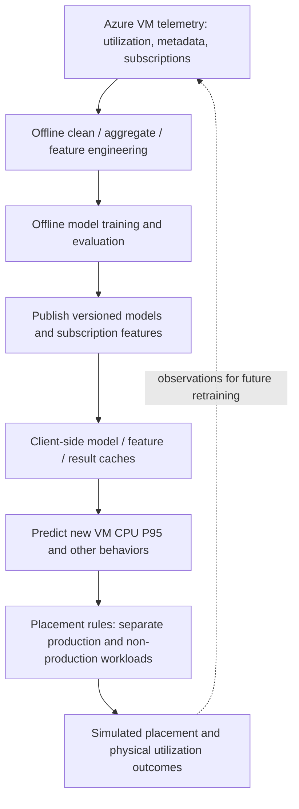
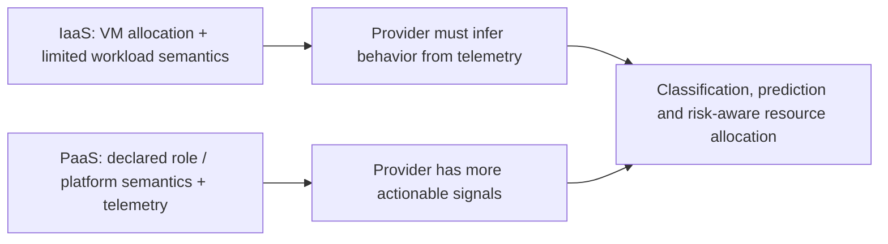
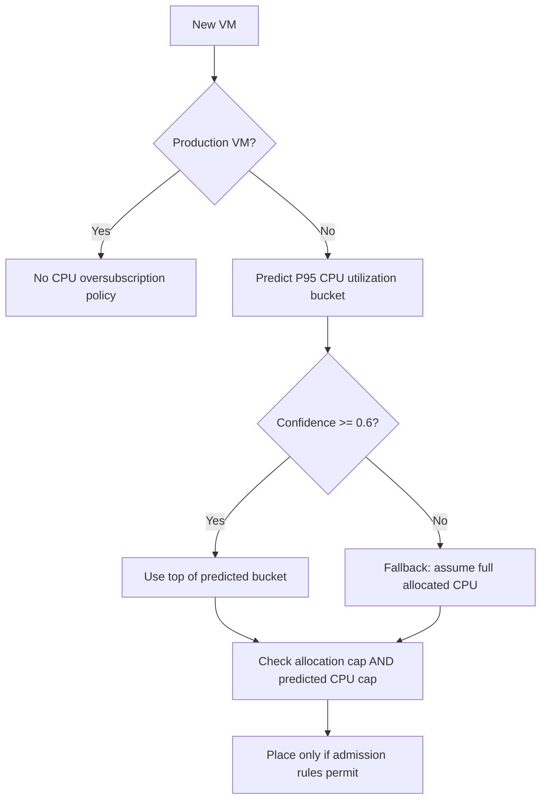
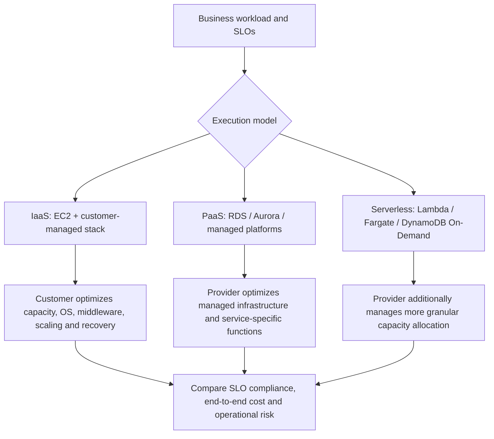
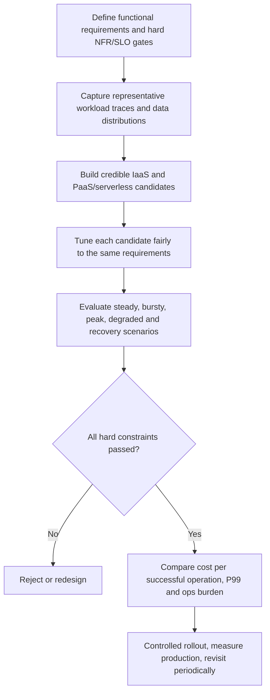
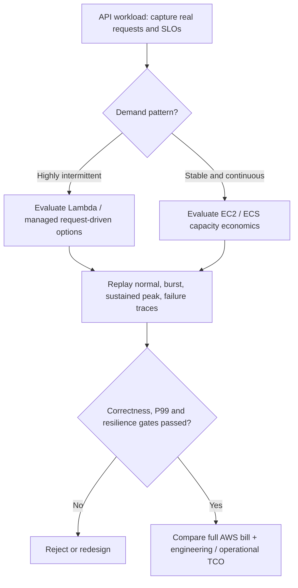

# Cloud Resource Optimization: PaaS/Serverless vs. Hand-Optimized IaaS

### Lessons from Microsoft Research’s *Resource Central* (SOSP 2017) and their application to AWS

**Architecture analysis report**  
**Date:** 31 October 2026  
**Scope:** AWS compute and database architecture; comparison of PaaS, serverless, and IaaS; Resource Central workload characterization, prediction-driven scheduling, and experimental methodology

## Executive summary

**Thesis:** For workloads that fit their abstractions, AWS PaaS and serverless services can deliver a better combination of performance, cost, reliability, and engineering productivity than an individually managed IaaS implementation—even one that has been carefully tuned.

This is not merely because they reduce system-administration work. AWS can optimize services at a level individual customers cannot easily reproduce: service-specific engines, fine-grained resource allocation, managed failure recovery, and—in services designed to share underlying infrastructure—fleet-level capacity management. AWS's Well-Architected Performance Efficiency guidance explicitly recommends using managed technologies, serverless architectures, and experiments to validate workload-specific choices [1].

**Research foundation:** The 2017 *Resource Central* paper analyzed Azure production VM traces, built offline workload-prediction models, and evaluated prediction-informed VM placement in simulation. It provides concrete evidence that provider-side telemetry and predictive resource management can improve **physical capacity utilization and scheduling outcomes**. It does **not** directly compare AWS PaaS/serverless bills or application performance with hand-optimized EC2, and its simulation was not a production deployment of the modified scheduler [13].

**But three claims must be kept separate:**

1. **Provider infrastructure efficiency:** AWS may run a service more efficiently at scale than a customer can run an equivalent stack on EC2.
2. **Customer total cost of ownership (TCO):** Delegating operational responsibilities can reduce engineering and operational costs.
3. **Customer performance per dollar:** A managed service is *not necessarily* cheaper or faster for a particular workload; its price, resource granularity, service semantics, and workload utilization determine the outcome.

**Decision rule:** Prefer managed services as *initial candidates*, require custom IaaS architectures to demonstrate a meaningful advantage, and validate both against the **same business workload, SLOs, failure conditions, and full cost model**. This is a practical recommendation, not a universal rule.

---

## Research case study: *Resource Central* (SOSP 2017)

### A. What the paper actually studied

**Source:** Eli Cortez et al., “Resource Central: Understanding and Predicting Workloads for Improved Resource Management in Large Cloud Platforms,” *SOSP 2017*, §§3–6 [13].

The authors studied **Microsoft Azure** VMs, not AWS. The trace covered **16 November 2016 – 16 February 2017**, with utilization statistics reported every five minutes. The paper describes many tens of millions of VMs spanning first-party services, infrastructure work, and external customers. For the evaluated Resource Central architecture, feature generation and model training occur offline; online predictions are served by a lightweight client-side library.

The primary optimization objective in its scheduling case study was to **fit more VM demand on existing physical servers** while limiting CPU-contention risk and avoiding VM deployment failures. This is a *provider-side physical scheduling* objective, not a direct comparison of retail PaaS and IaaS prices.

### B. Workload facts that create optimization opportunities

| Reported observation | Paper evidence | Optimization implication |
|---|---|---|
| **60% of VMs** averaged less than **20% CPU** | §3.2, Fig. 1 [13] | Nominally allocated capacity substantially exceeds *average* demand for many VMs. |
| **40% of VMs** had a 95th-percentile of measured maximum CPU utilization below **50%** | §3.2, Fig. 1 [13] | Some VMs are candidates for denser placement even after considering elevated demand. |
| **80% of subscriptions** had a coefficient of variation below **1** for average CPU utilization across their VMs | §3.2 [13] | Subscription history can provide useful prediction features. This does not imply every future VM is predictable. |
| **68% of core-hours** were attributed to delay-insensitive workloads (under the paper's heuristic classification) | §3.6, Fig. 6 [13] | Different interference tolerances may justify different resource-management policies. |
| PaaS was **48% of VMs** and about **61% of total core-hours** | §3.1 [13] | The workload composition differs by service type. **Core-hour share is not evidence that PaaS is more efficient than IaaS.** |

**Coefficient of variation (CoV):**

\[
\mathrm{CoV} = \frac{\sigma}{\mu}
\]

The paper computed this across VM behaviors grouped by customer subscription. Low CoV for many subscriptions supports using prior customer history, but it is not a guarantee of low variance in instantaneous CPU usage, nor a promise of accurate performance under every correlated peak.

**An especially important nuance:** The authors observed that some first-party services kept CPU usage low by **overprovisioning VMs for predictable low latency**. Thus low average utilization is sometimes *intentional reliability/performance headroom*, not automatically waste to eliminate (§3.2 [13]).

### C. Why a PaaS abstraction can help the provider

In this study, Azure's PaaS VM roles included semantic categories such as **Web server** and **worker**. The authors explain that such roles can offer clues about expected latency sensitivity, whereas an opaque IaaS VM reveals less about its application (§3.1 [13]).

**Transferable lesson:** When an AWS managed service has richer knowledge of a workload's semantics or lifecycle, AWS *may* have more room to optimize scheduling, caching, replication, recovery, or scale-down than an opaque customer-managed EC2 workload allows.

**Boundary:** The historical Azure PaaS VM role model is not equivalent to every current AWS service labeled “PaaS” or “serverless.” This is an architectural analogy, **not** proof that Lambda, Fargate, DynamoDB, or Aurora uses Resource Central's algorithms.

### D. Models and offline evaluation: prediction is not a magic scheduler

Resource Central made **separate predictions for different targets**, using algorithms selected by data analysts. Its architecture did **not automatically select Random Forest versus gradient boosting** (§4.2 [13]).

| Prediction target | Reported approach | Overall bucket accuracy |
|---|---|---:|
| Average VM CPU utilization | Random Forest | 81% |
| P95 maximum VM CPU utilization | Random Forest | 83% |
| Deployment size, VM count | Extreme Gradient Boosting Trees | 83% |
| Deployment size, core count | Extreme Gradient Boosting Trees | 86% |
| VM lifetime | Extreme Gradient Boosting Trees | 79% |
| Workload class | FFT + Extreme Gradient Boosting Trees | 90% |

*Source: Tables 1 and 4 in [13]. Values are the authors' defined bucket-classification accuracy, not exact percentage-point regression accuracy. The paper used Microsoft's TLC framework; “Extreme Gradient Boosting Trees” here should not be read as confirmation that a particular external XGBoost software package was used.*

The paper evaluated model quality using **two months of training data and the following month's test data** (§6.1 [13]). This is preferable to random cross-time splits when the actual use case is forecasting new VM behavior. For an AWS design exercise, use *rolling future-period validation* and reserve an untouched test window for the final architecture or model decision.

### E. Safety-oriented decision logic: prediction plus conservative constraints

The modified scheduler made an important separation between resource **allocations** and predicted resource **demand**:

- It considered CPU oversubscription only for **non-production VMs** under the study's policy; production VMs were placed on non-oversubscribable servers.
- It checked **two independent limits**: the sum of allocated virtual CPU against a maximum oversubscription cap (`MAX_OVERSUB`), and the sum of predicted high-percentile CPU use against a physical CPU utilization cap (`MAX_UTIL`).
- For a CPU prediction below its **0.6 confidence threshold**, the scheduler conservatively assumed the VM might consume its *entire allocation*. For a confident bucket prediction, it used the **upper edge** of the predicted utilization bucket.
- The authors evaluated both hard and soft-rule alternatives and varied caps to expose the placement-failure versus overutilization trade-off (§§5–6.2 [13]).

**Design principle:** Optimize an *expected* resource demand only within explicit **risk constraints**. Do not treat predicted spare capacity as guaranteed, and do not oversubscribe a highly latency-sensitive production workload merely because its historical average is low.

### F. Measured outcomes — and what they do *not* establish

The scheduling evaluation replayed roughly **336,000 VM arrivals** over a month on a modeled cluster of **880 physical servers**, each with **16 cores and 112 GB RAM**. The default experiment allowed allocations up to **125% of physical CPU** and targeted **100% maximum predicted CPU use** (§6.2 [13]).

| Scheduling method | Deployment scheduling failures | Physical CPU utilization observations above 100% |
|---|---:|---:|
| No CPU oversubscription (baseline) | **0.25% of VM arrivals** | **0** |
| Resource Central–informed oversubscription | **0** | **77 observations** across all servers/month |
| Naive oversubscription, no predictions | **0** | **Approximately 6×** as many as prediction-informed |

These measurements support the paper's narrower claim: **prediction-informed placement improves capacity acceptance while controlling modeled overload risk**, relative to simple alternatives. It *does not* establish zero application-level latency degradation or prove superior AWS PaaS/serverless economics. The modified scheduler was assessed in **simulation using real traces**, and the authors explicitly state the changes were **not yet deployed in production** (§6.2 [13]).

Also, the paper assessed **CPU oversubscription** (not the oversubscription of physical memory, network, or disk). A server observation over 100% means the combined modeled demand exceeds one physical core per virtual core at that sample interval; the paper did not reproduce arbitrary customer application SLOs.

**Further engineering result:** Predictions were served locally via caches and client-side execution: result-cache hits had about **1.3 µs P99** latency; model execution P99 ranged **139–258 µs** depending on target, while remote feature retrieval was around **5.6 ms P99** (§6.1 [13]). This supports keeping frequent control-loop decisions off a remote inference service's critical path when the models and data are small enough.

### G. How this changes our original PaaS/serverless thesis

| Claim | Evidence level after reading *Resource Central* |
|---|---|
| Providers can use cross-customer telemetry and predictive placement to increase infrastructure utilization | **Directly supported** for the study's Azure VM workloads and simulator [13] |
| Some PaaS abstractions reveal more workload semantics than opaque IaaS VMs | **Directly discussed** for the paper's Azure PaaS roles [13] |
| More detailed workload information can enable safer fine-grained optimization | **Mechanistically supported**; concrete benefit depends on the policy and workload [13] |
| AWS Lambda/Fargate/Aurora/DynamoDB are always cheaper than an optimized EC2 design | **Not established**; must be evaluated with AWS prices and real traffic |
| Resource Central's 2017 models or scheduler are the methods used by AWS today | **Not established**; no such implication should be made |

The most rigorous conclusion is therefore:

> **Specialized managed platforms have a structural opportunity to optimize resources better than opaque, manually managed infrastructure. *Resource Central* demonstrates one effective provider-side mechanism; it does not remove the need for AWS-specific workload and cost validation.**

---

## 1. Optimization opportunities by abstraction level

*Terminology note:* PaaS, managed service, and serverless are overlapping rather than mutually exclusive categories. For example, DynamoDB is both a managed database and serverless; Fargate is serverless container compute; Aurora Serverless v2 is a managed relational database with elastic compute capacity. EC2 is an IaaS service, though customers can still automate it extensively.

| Dimension | Self-managed on EC2 | PaaS / serverless opportunity |
|---|---|---|
| Capacity granularity | VM, ASG, cluster, application process | May scale at function, task, request, or managed capacity-unit granularity |
| Workload specialization | Generic infrastructure plus customer software | Database-, container-, function-, or event-aware optimizations |
| Fleet management | Customer manages its own allocated resources | Provider manages underlying fleets and may pool capacity where architecture permits |
| Recovery / maintenance | Substantial customer responsibility | Provider takes on more platform responsibilities; customer still owns application correctness |
| Tuning flexibility | Extensive OS/runtime/engine control | Constrained by the service interface and supported parameters |
| Economic model | Capacity-based, often with commitment discounts | Frequently consumption-based; actual charging model varies by service |

AWS's design guidance recognizes both the advantages of delegating complex infrastructure to managed services and the need to match technology to application access patterns [1].

## 2. Why provider-side optimization can be stronger

**Connection to Resource Central:** Prediction-informed placement adds a different but complementary lever to ordinary multiplexing: it uses *forecasts of demand and uncertainty* to decide which VMs may safely share physical capacity. This is a stronger idea than simply counting unused vCPUs [13].

### 2.1 Multiplexing and statistical capacity pooling

An isolated application fleet needs enough capacity for its own demand spikes. Where workloads peak at different times, a shared fleet may need less total peak capacity than the sum of separately provisioned fleets:

\[
\max_t\left(\sum_{i=1}^{n}D_i(t)\right)
\leq \sum_{i=1}^{n}\max_t D_i(t)
\]

Here, \(D_i(t)\) is the resource demand of workload \(i\) at time \(t\). The inequality describes a *potential* advantage, not a statement about how any particular AWS service physically shares customer resources. Isolation, headroom, placement, redundancy, and correlated peaks all affect realized savings.

### 2.2 Service-aware implementation

A service that knows the workload semantics has additional optimization opportunities:

- **Aurora:** its distributed, shared storage subsystem and multi-AZ replication are part of the managed database design, not something reproduced by merely changing EC2 instance sizes [2].
- **DynamoDB:** provides managed throughput scaling and a key-value/document API. This can be efficient for supported access patterns, but inappropriate data modeling can undermine latency and cost [3].
- **Lambda:** manages execution-environment creation and reuse, freeing customers from maintaining a permanently running application-server fleet; cold starts can still affect tail latency [4].
- **Fargate:** removes host-fleet management for container workloads, but task-level CPU and memory right-sizing remain necessary [5].

### 2.3 Continuous platform investment

A managed platform centralizes engineering effort across service customers. Customers can benefit from platform improvements without recreating the platform internally. However, these improvements do **not** guarantee superior application-level performance: application data models, concurrency controls, query patterns, connection behavior, and service quotas still matter.

---

## 3. Provider efficiency is not the same as customer savings

A provider can operate a service efficiently yet charge a premium for convenience, elasticity, or specialized functionality. Conversely, a customer can run inexpensive EC2 capacity while paying substantial engineering and maintenance costs.

A more defensible total-cost model is:

\[
TCO = C_{AWS} + C_{engineering} + C_{operations} + C_{migration} + E[C_{incidents}]
\]

For a transaction-processing system, the primary efficiency metric can be:

\[
\text{Cost per successful operation within SLO}
= \frac{\text{Total relevant cost}}{\text{Number of valid operations completed within SLO}}
\]

Measure this *only after* correctness, security, reliability, and recovery requirements pass. A very cheap architecture that loses writes or violates the latency SLO is not an acceptable optimization.

| Workload pattern | Why PaaS / serverless may win | Why IaaS / provisioned resources may win |
|---|---|---|
| Intermittent, event-driven activity | Minimal or reduced idle compute charges; execution follows demand | Dedicated warm capacity may give better latency predictability |
| Unpredictable key-value traffic | DynamoDB On-Demand avoids detailed throughput provisioning | Provisioned capacity can cost less for steady, predictable throughput [3] |
| Variable relational OLTP | Aurora Serverless v2 scales database compute; compatible configurations can auto-pause at zero ACUs | Provisioned Aurora or EC2 PostgreSQL can be preferable for sustained utilization or specific custom requirements [6] |
| Stable, high-utilization CPU workloads | Managed operations still offer value | EC2-based capacity can achieve a favorable cost per CPU-hour, particularly with effective discounts |
| Specialized database access | Purpose-built engine can eliminate substantial infrastructure development | Custom extensions, unusual semantics, specialized hardware, or incompatible access patterns may demand EC2 |

AWS's cost guidance recommends modeling workload usage over time and comparing pricing models, rather than assuming one is cheapest [7].

---

## Terminology: three concepts that must never be conflated

| Concept | Definition | Relevant example |
|---|---|---|
| **Customer overprovisioning** | Buying or reserving more capacity than current demand requires, perhaps intentionally for peaks/reliability | Running extra EC2 nodes to preserve low P99 latency |
| **Provider CPU oversubscription** | Assigning virtual CPU allocations whose total exceeds a physical CPU capacity, subject to scheduling policy | *Resource Central* CPU placement experiment [13] |
| **T-family CPU bursting / credits** | A customer-facing baseline-versus-burst accounting/performance contract | `t3.large` Standard versus Unlimited mode [8–10] |

The *Resource Central* simulated oversubscription policy is **not the same thing** as AWS T-family CPU-credit behavior. It is also different from customers choosing more EC2 instances than typical traffic needs.

---

## 4. EC2 T-family versus fixed-performance instances: a benchmarking trap

**T instances are burstable, not simply 'ordinary 2-vCPU instances that happen to be cheaper.'** Their CPU model includes a baseline and a CPU-credit mechanism [8]. This is distinct from the architectural concept of over-provisioning excess server capacity.

| Mode / family | CPU behavior | Cost consideration |
|---|---|---|
| **T Standard** | Bursts above baseline using accumulated credits; if credits run low, performance gradually approaches baseline | No paid surplus-CPU credits under Standard |
| **T Unlimited** | Can continue above baseline after accrued credits are depleted | Sustained usage above baseline can incur surplus-credit charges |
| **M/C/R fixed-performance** | No T-family CPU-credit baseline limitation | Pay for provisioned capacity; instance selection and utilization determine efficiency |

**Example:** AWS documents a `t3.large` baseline of **30% CPU utilization per vCPU** [9]. T3, T3a, T4g, and T8i generally launch in Unlimited mode by default (subject to documented exceptions/configuration) [10].

A ten-minute CPU benchmark could favor a T instance during a burst yet fail to reflect its **Standard-mode long-run throughput** or **Unlimited-mode total charges**. When comparing with M/C/R or serverless compute, record:

- `CPUCreditBalance`, `CPUSurplusCreditBalance`, and `CPUSurplusCreditsCharged` as applicable;
- Standard vs Unlimited mode and initial credit state;
- sustained throughput, P95/P99 latency, warm-up and test duration;
- the **full incremental bill**, including any surplus credits.

**Do not infer physical oversubscription mechanics from the CPU-credit contract alone.** The documented customer-facing distinction is baseline/burst accounting.

---

## 5. Proposed experimental method for AWS architecture selection

The same empirical discipline used to compare machine-learning algorithms can be applied to architecture selection: define one problem, provide comparable inputs, tune each candidate fairly, validate across representative periods, and select using business-sensitive error costs.

### Step 1 — Fix the business problem

Specify functionality, transaction semantics, consistency, data durability, security boundaries, query patterns, throughput, P99 latency, availability, RTO/RPO, and regulatory constraints **before selecting services**.

### Step 2 — Build comparable candidates

Examples:

- EC2 + PostgreSQL + customer-managed replication **vs** RDS PostgreSQL **vs** Aurora.
- ECS on EC2 **vs** ECS on Fargate **vs** Lambda, where the application can meaningfully run on each platform.
- Self-managed key-value database **vs** DynamoDB, provided both implement *equivalent* user-visible behavior.

Different architectures will necessarily use different physical resources and tuning controls. **Fairness means equivalent requirements and representative workload—not artificially equal vCPU counts or identical topology.**

**Resource Central-inspired evaluation protocol:** Before selecting the winning AWS architecture, capture a forward-looking demand distribution and compare policies rather than just static instance counts: (a) fixed IaaS capacity, (b) scaling policies, (c) PaaS/serverless execution, and (d) optional forecast-informed scaling. Validate the **same future request trace**, include uncertainty bands and correlated peaks, and apply a **conservative fallback** when a predictor is unavailable or unreliable. Do not claim this requires AWS to implement Resource Central internally; this is a customer-side experiment inspired by the paper [13].

### Step 3 — Exercise diverse periods and failure modes

| Scenario | What it reveals |
|---|---|
| Low-utilization hours | Idle capacity cost and scale-down effectiveness |
| Normal demand | Typical latency and steady-state operating cost |
| Burst / traffic ramp | Scale-up behavior, queuing, throttling, cold starts |
| Sustained peak | Long-run throughput, credits, concurrency ceilings, heat |
| Skewed access / large transactions | Hot keys, contention, query costs, partition effects |
| AZ or dependency impairment | Recovery behavior, retries, lost requests, duration of SLO violations |
| Future-period workload replay | Robustness to workload drift and seasonality |

AWS recommends production-like load tests with representative traffic and attention to bottlenecks [11]. AWS Fault Injection Service guidance recommends defining steady-state metrics and a testable failure hypothesis [12].

### Step 4 — Apply hard gates before optimization

Reject any candidate that fails required correctness, security, data-durability, RTO/RPO, or latency thresholds. For surviving designs, compare:

- **Performance:** successful throughput, P50/P95/P99, scaling response, jitter.
- **Reliability:** error rate, failed writes, recovery time, degraded-period SLO violations.
- **Economics:** compute, requests, storage, I/O, transfer, observability, backup, commitments, support and engineering time.
- **Operability:** patching, upgrades, incident response, deployability, expertise, lock-in and change risk.

A sample decision equation is:

\[
A^*=\arg\min_{A\in\mathcal{F}} TCO(A)
\]

where \(\mathcal{F}\) is the set of architectures that satisfy all mandatory functional and nonfunctional requirements. If latency or reliability beyond the minimum is valuable, compare the Pareto frontier instead of forcing arbitrary weights into one score.

### Step 5 — Validate in controlled production

Use staged exposure, observe production telemetry, and reevaluate periodically as pricing, instance generations, AWS functionality, and traffic change. A workload-specific winner today may not be the winner next year.

---

## AWS implementation lessons derived from *Resource Central*

The AWS examples below are **engineering extrapolations**, not experiments conducted by the authors.

| Paper principle | AWS-side implementation idea | How to test it |
|---|---|---|
| Predict from customer/workload history | Use CloudWatch utilization and request-rate history; where warranted, train demand forecasts for EC2/ECS capacity planning | Compare against target-tracking and scheduled scaling under held-out traffic |
| Distinguish latency-sensitive and delay-tolerant work | Isolate front-end APIs from batch work; use appropriate queues, concurrency controls, and capacity classes | Measure application P99 during simultaneous peak/batch events |
| Resource semantics help scheduling | Prefer managed database/compute abstractions if their API matches the workload | Compare full operations and unit cost, not equal vCPU counts |
| Bound oversubscription by risk | Apply hard limits to batch concurrency, queue admission, and overcommit policies; reserve headroom for critical services | Inject demand spikes and failures; record SLO violations and recovery |
| Use prediction confidence | Apply conservative capacity defaults when history is insufficient, drift is detected, or confidence is low | Measure underprediction frequency and adverse business effects |
| Keep hot decisions local | Use simple, predictable policies and caching on critical paths; keep heavy model training asynchronous | Measure decision overhead at P99 and behavior if model/feature store is unavailable |
| Retrain / retest against future windows | Repeat representative benchmarks as workload, pricing, and instance technology evolve | Rolling validation and periodic cost/performance reviews |

### Example decision: sustained API traffic versus intermittent API traffic

**Illustrative hypothesis, not a published benchmark:**

A forecast-informed EC2 fleet might be competitive with serverless for predictable traffic; serverless may remove the need for that customer-managed forecast entirely for intermittent traffic. Conversely, fixed optimized compute might win economically at sufficiently high utilization. **Both conclusions require measurement**.

---

## 6. Service-selection heuristics

| If the workload is... | Start by evaluating... | Validate especially... |
|---|---|---|
| Sporadic, stateless request/queue processing | Lambda | Cold-start and P99 latency; invocation and concurrency economics |
| Containerized and bursty | Fargate | CPU/memory sizing, scaling delay, task cost vs ECS on EC2 |
| Sustained CPU-heavy services | EC2 C/M family or ECS on EC2; compare Fargate | Utilization, commitment pricing, operational cost |
| Standard relational transactions | RDS PostgreSQL / Aurora | SQL compatibility, joins, transactions, read/write behavior, HA cost |
| Variable relational demand | Aurora Serverless v2 | ACU floor/ceiling, scaling, minimum charges, connection/restart behavior |
| Predictable key-value volume | DynamoDB provisioned and On-Demand | Request-unit economics, hot keys, GSI costs, capacity efficiency |
| Irregular key-value volume | DynamoDB On-Demand | Burst behavior, request-unit costs, throttling and maximum settings |
| Legacy/custom database engine needs | EC2 | Customization necessity versus self-management and recovery costs |

**PaaS does not remove the need to optimize applications.** It changes *where* optimization effort is spent: data modeling, query design, batch sizes, retries, connection management, demand shaping, and workload architecture become relatively more important than OS and host administration.

## 7. Conclusions and recommended policy

1. **Use workload history and workload classes as first-class inputs.** Resource Central shows how telemetry, subscription history and conservative policy constraints can improve a cloud provider’s physical scheduling, while also showing that application latency headroom must not be mistaken for free capacity [13].
2. **Default to managed-first evaluation**, not managed-only adoption. An existing managed service is a strong baseline because platform engineering and operational features are already packaged.
3. **Value optimization at the application outcome level**, not at the nominal vCPU or instance-price level. Measure successful transactions within SLO and full lifecycle TCO.
4. **Account for AWS's specialization and economies of scale**, but distinguish provider resource efficiency from the customer's actual bill.
5. **Challenge IaaS when it replicates a mature platform**, while recognizing legitimate exceptions: sustained utilization, customization, hardware control, precise tail-latency requirements, or portability.
6. **Treat T-family CPU credits, serverless cold starts, provisioned floors, and burst pricing as first-class test variables.** These mechanisms can reverse simplistic benchmark results.
7. **Make the final choice empirically**, across normal traffic, peaks, failures, and changes over time.

> **Central recommendation:** Use the highest level of managed abstraction that satisfies the workload's real requirements, unless an alternative demonstrates meaningfully better total outcomes under fair, representative testing.

---

## References — AWS primary documentation

[1] [AWS Well-Architected — Performance Efficiency design principles](https://docs.aws.amazon.com/wellarchitected/latest/framework/perf-dp.html)  
[2] [Amazon Aurora storage architecture](https://docs.aws.amazon.com/AmazonRDS/latest/AuroraUserGuide/Aurora.Overview.StorageReliability.html)  
[3] [DynamoDB capacity modes: On-Demand and provisioned](https://docs.aws.amazon.com/amazondynamodb/latest/developerguide/capacity-mode.html)  
[4] [Lambda execution environment lifecycle and cold starts](https://docs.aws.amazon.com/lambda/latest/dg/lambda-runtime-environment.html)  
[5] [AWS Containers Blog — ECS/Fargate cost optimization checklist](https://aws.amazon.com/blogs/containers/cost-optimization-checklist-for-ecs-fargate/)  
[6] [Aurora Serverless v2 auto-pause and resume](https://docs.aws.amazon.com/AmazonRDS/latest/AuroraUserGuide/aurora-serverless-v2-auto-pause.html)  
[7] [AWS Well-Architected — Select the best pricing model](https://docs.aws.amazon.com/wellarchitected/latest/cost-optimization-pillar/select-the-best-pricing-model.html)  
[8] [EC2 burstable performance instance concepts](https://docs.aws.amazon.com/AWSEC2/latest/UserGuide/burstable-credits-baseline-concepts.html)  
[9] [EC2 Unlimited CPU-credit calculation and t3.large example](https://docs.aws.amazon.com/AWSEC2/latest/UserGuide/burstable-performance-instances-unlimited-mode-concepts.html)  
[10] [EC2 burstable instance mode defaults](https://docs.aws.amazon.com/AWSEC2/latest/UserGuide/burstable-performance-instances-how-to.html)  
[11] [AWS Well-Architected — Load test your workload](https://docs.aws.amazon.com/wellarchitected/latest/framework/perf_process_culture_load_test.html)  
[12] [AWS Fault Injection Service — Planning experiments](https://docs.aws.amazon.com/fis/latest/userguide/getting-started-planning.html)

## Primary research paper

[13] Cortez, E., Bonde, A., Muzio, A., Russinovich, M., Fontoura, M., and Bianchini, R. (2017). **Resource Central: Understanding and Predicting Workloads for Improved Resource Management in Large Cloud Platforms.** *Proceedings of the 26th ACM Symposium on Operating Systems Principles (SOSP 2017)*, pp. 153–167. [Open-access PDF from Microsoft Research](https://www.microsoft.com/en-us/research/wp-content/uploads/2017/10/Resource-Central-SOSP17.pdf) · [DOI](https://doi.org/10.1145/3132747.3132772). Paper sections particularly used: §3 workload characterization, §4 Resource Central architecture/model selection, §5 scheduler policy, and §6 experimental evaluation.

*Evidence note:* AWS documentation establishes documented capabilities, cost mechanisms, and recommended evaluation practices. It does not establish that PaaS/serverless universally outperforms customer-tuned IaaS. Performance and pricing superiority are workload-dependent hypotheses requiring controlled measurement. Mermaid diagrams, AWS extrapolations, and comparison heuristics are analytical illustrations, not Resource Central benchmark figures. Only numerical results explicitly attributed to paper [13] should be interpreted as paper measurements or simulation outputs. The paper’s Azure 2016–2017 environment should not be assumed to represent current AWS capacity or pricing.
